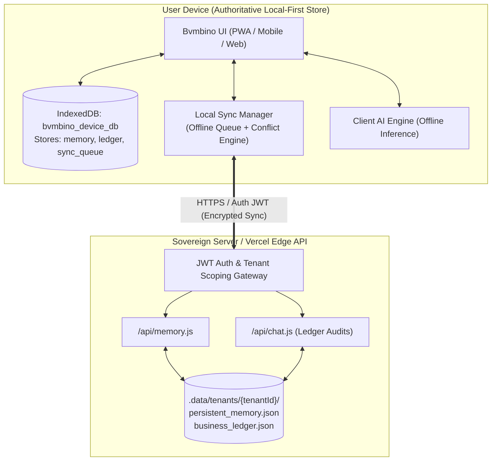

# Bvmbino Local-First Persistence & Recovery Architecture

## 1. Executive Summary & Core Philosophy

Bvmbino is architected as a **Local-First, Sovereign Enterprise AI Application**. The authoritative source of truth for all interactive workflows, knowledge facts, and ledger events is the **user's local device storage** (backed by IndexedDB with graceful localStorage fallback), augmented by cryptographically secured, tenant-isolated server-side persistence (`.data/tenants/{tenantId}/`).

---

## 2. Storage Subsystems

### A. Device-Side Store (`bvmbino_device_db`)
- **Primary Engine**: IndexedDB (Database: `bvmbino_device_db`, Version: `1`).
- **Object Stores**:
  - `memory_items`: Categorized facts (`confirmed_fact`), working assumptions (`assumption`), and targets (`target`).
  - `ledger_records`: Audited and pending business invoices, contracts, and payouts.
  - `sync_queue`: Outbox of optimistic mutations queued while offline or during intermittent connectivity.
  - `metadata`: Schema version, local device identifier, and last successful sync timestamp.
- **Fallback Engine**: In environments where IndexedDB is blocked or restricted (e.g. private browsing or certain webview containers), the client transparently degrades to structured `localStorage` with JSON serialization.

### B. Server-Side Partitioned Store (`.data/tenants/{tenantId}/`)
- **Tenant Isolation**: Server storage is strictly partitioned per tenant (`tenantId` extracted and sanitized from verified JWT claims).
- **Files per Tenant**:
  - `persistent_memory.json`: Tiered memory items, profile metadata, and conversation summaries.
  - `business_ledger.json`: Business records with strict verification states (`verified`, `reconciled`, `pending_review`, `disputed`).
- **Authorization Boundary**: Cross-tenant access is forbidden at the gateway level (`403 Forbidden`). Client A can never view, update, supersede, or delete Client B's data.

---

## 3. Resilience Scenarios & Resolution Strategies

### Scenario 1: A User Loses Internet Access
1. **Seamless Local Operation**: The application detects `navigator.onLine === false` and routes all memory queries, deduplication checks, and ledger additions directly to the local IndexedDB.
2. **Local AI Inference**: If the user is on mobile or disconnected, Billy invokes the `Client AI Engine` / local model relay rather than failing over cloud endpoints.
3. **Optimistic Outbox Queue**: All state changes (`add_item`, `update_item`, `add_record`, `verify_record`) are recorded locally with `syncStatus: 'pending'` and pushed to the `sync_queue` store.
4. **Auto-Reconnection Sync**: When network connectivity returns (`online` event), the `SyncManager` flushes the outbox in chronological order via authenticated batch requests to `/api/memory`.

### Scenario 2: Browser Storage is Cleared
1. **Zero Data Loss**: If a user clears their browser cache or uses a fresh browser session, local device IndexedDB is initially empty.
2. **Authentication Challenge**: The user enters their credentials (`ADMIN_USER` / password) or presents a valid session token.
3. **Tenant Hydration**: Upon successful authentication, the frontend invokes `GET /api/memory` with the caller's JWT token.
4. **Local DB Restoration**: The server returns the authoritative tenant-scoped snapshot. The client initializes `bvmbino_device_db` and repopulates `memory_items` and `ledger_records`.

### Scenario 3: A User Changes Devices (e.g. Laptop to Mobile Phone)
1. **Device Identification**: Each client instance generates or maintains a local `deviceId`.
2. **Tenant Re-association**: The user logs in on the new device. The server validates credentials and issues a scoped JWT containing `sub` and `tenantId`.
3. **Full Snapshot Pull**: The new device calls `GET /api/memory` and `GET /api/memory?action=export`.
4. **Local Mirror Construction**: The new device constructs its local IndexedDB mirror without conflicting with prior devices. Subsequent local changes are synced back to the tenant namespace.

### Scenario 4: A Customer Restores a Backup
1. **Backup Format Standard**: Backups are exported as standardized JSON bundles conforming to Schema Version 3 (`exportVersion: 3`, containing `profile`, `memoryItems`, `summaries`, `ledgerRecords`, and `tenantId`).
2. **Restore Modes**:
   - **Merge Mode (Default)**: Existing records are preserved. Incoming records are added if absent. If an incoming record has a newer `updatedAt` timestamp, it updates the existing entry.
   - **Replace Mode**: Overwrites the existing memory and ledger state completely with the backup contents, resetting audit indices while retaining tenant isolation.
3. **Verification Integrity Guard**: During ledger restoration, records lacking verifiable `evidenceRef` automatically default to `pending_review`. Only explicitly confirmed records with valid references contribute to audited financial totals.

### Scenario 5: Two Devices Modify the Same Memory Item Concurrently
1. **Timestamped Revisions**: Every memory item and ledger record carries an ISO 8601 `updatedAt` timestamp and an incremental `version` counter.
2. **Conflict Resolution Policy**:
   - **Last-Write-Wins (LWW)**: For simple metadata edits (e.g., tags, category), the modification with the latest `updatedAt` timestamp is accepted.
   - **Supersede Audit Chaining**: For substantive fact updates, Bvmbino avoids silent overwrites. When a factual discrepancy is detected across revisions:
     - The existing fact is marked `superseded` (`status: 'superseded'`).
     - A pointer `supersededBy: new_fact_id` is written into the audit trail.
     - The new fact is saved with `supersedes: old_fact_id`.
     - Both versions remain queryable for audit integrity, guaranteeing zero silent data loss.

---

## 4. Verification and Security Compliance

| Threat / Risk | Mitigating Control | Verification Test |
|---|---|---|
| Cross-tenant data leakage | Tenant-scoped paths, JWT `tenantId` claim validation, 403 enforcement | `tests/tenant_isolation.test.js` |
| Fabricated financial records | New records default to `pending_review`; audited totals strictly require valid `evidenceRef` | `tests/financial_verification.test.js`, `tests/verified_records.test.js` |
| Data loss on device wipe | Authenticated server hydration of tenant-scoped snapshot | `tests/persistent_memory.test.js` |
| Concurrent update race | Last-Write-Wins with supersede audit pointers | `tests/memory_hub.test.js` |
| Offline failure | IndexedDB local storage engine with sync queue | `tests/persistence_device.test.js` |
