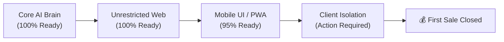
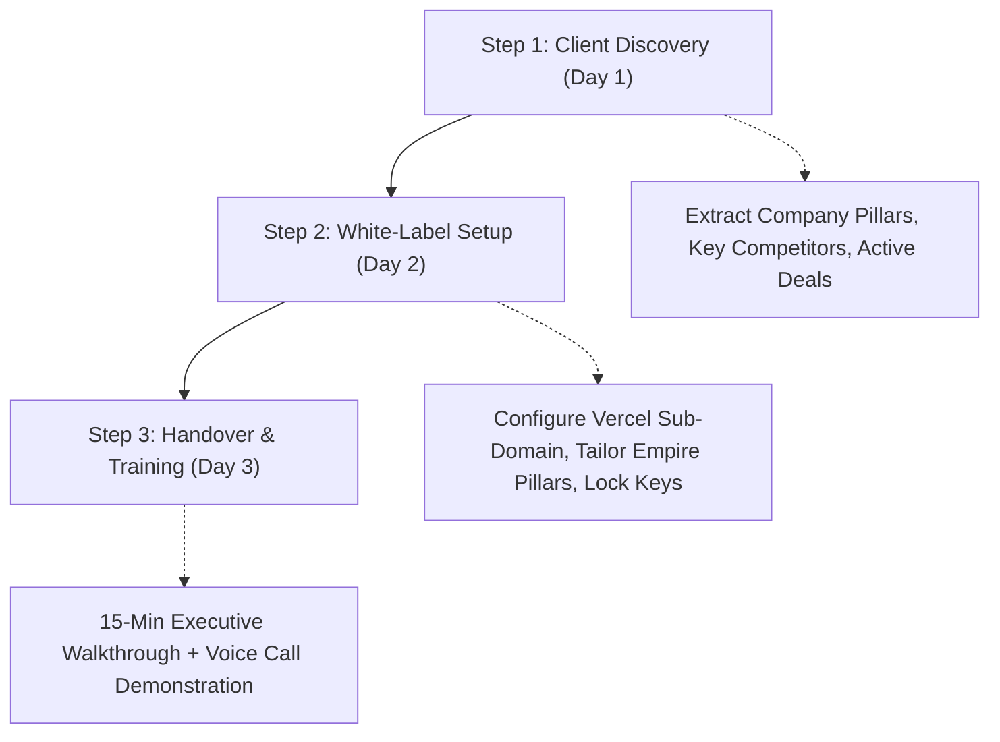

# 🏰 FIRST TO SELL: Commercial Playbook & Client Deployment Blueprint
**Bvmbino Sovereign AI Chief of Staff · Private Enterprise Edition**

---

## Executive Summary

The **Bvmbino Sovereign AI Agent** has graduated from a personal development prototype into an **enterprise-ready, sovereign Chief of Staff platform**. With a primary orchestrator (**Billy**), 24 domain-specialist agents, real-time unrestricted web intelligence, and an Obsidian-grade continuous memory core, this system replaces fragmented SaaS subscriptions with a single private command center.

This blueprint outlines the exact steps to package, price, deploy, and sell this system to your first paying business client.

---

## 1. Readiness Scorecard & Audit

| Component | Status | Operational Capability |
| :--- | :---: | :--- |
| **Billy Sovereign Orchestrator** | **100%** | Primary lead agent; delegates seamlessly to 24 domain specialists. |
| **Unrestricted Web Intelligence** | **100%** | Autonomous keyless live search & scraping (DuckDuckGo + Jina Reader). |
| **Frontier Multi-Model Cascade** | **100%** | Llama 3.3 70B, Claude 3.5 Sonnet, GPT-4o, Gemini 2.0 Flash, Cerebras (~1,800 tok/s). |
| **Continuous Memory Core** | **100%** | Obsidian-grade context retention with active session rehydration. |
| **Document Export Engine** | **100%** | High-fidelity 1-click PDF, HTML, and Markdown document generation. |
| **Voice Interface (Billy Live)** | **95%** | Bidirectional STT/TTS with natural male cadence and multilingual support. |
| **Multi-Tenant Client Isolation** | **Action** | Dedicated client sub-domain or database separation for commercial release. |

---

## 2. Commercial Packaging & Pricing Strategy

Do **not** sell this platform as a generic \$20/month AI chatbot. Position it as a **High-ROI Executive Solution**: an autonomous Chief of Staff and strategic back-office team.

### Tier 1: Private Executive Edition (Solo Founders, Sports Agents, Executives)
* **Setup Fee**: \$1,500 – \$2,500 (one-time onboarding & customization)
* **Monthly Retainer**: \$350 – \$500 / month
* **Deliverables**:
  * Dedicated private instance (e.g., `client.bvmbino.com`).
  * Custom company pillars, target clients, and competitor tracking configured.
  * Voice interface (Billy Live) configured for hands-free executive updates.
  * Unlimited live web research, market data, and exportable executive reports.

### Tier 2: Enterprise Agency / Team Edition (SMEs, Boutiques, Real Estate, Sports Clubs)
* **Setup Fee**: \$3,500 – \$5,000 (one-time)
* **Monthly Retainer**: \$750 – \$1,200 / month
* **Deliverables**:
  * Full 24-agent team tailored to agency workflows (Sales, Legal, Tech, Content, Ops).
  * Direct webhook automations (n8n, Slack alerts, CRM data ingestion).
  * Custom brand theme, company logo, and executive persona styling.
  * Dedicated SLA, weekly memory updates, and priority model routing.

---

## 3. The 3-Step First Client Deployment Walkthrough

### Step 1: Discovery & Knowledge Ingestion (1 Hour)
Collect the client's core business context:
1. **Empire Pillars**: Their top 3–4 business ventures or active departments.
2. **Current Priorities**: Immediate goals (e.g., closing deals, scouting athletes, content expansion).
3. **Audience & Competitors**: Specific competitors to track and target prospect criteria.

### Step 2: Instance Configuration & Deployment (2 Hours)
1. Fork or branch repository to a private deployment.
2. Assign custom domain: `https://agent.[clientbrand].com` via Vercel.
3. Pre-seed the **Empire Pillars** and **Obsidian Memory Vault** with their specific discovery data.
4. Set server-side API keys in Vercel environment variables so client credentials remain 100% secure.

### Step 3: Executive Handover & 'Aha!' Moment (30 Minutes)
Run a live demonstration proving unmatched capability:
1. **Live Web Intelligence Test**: Ask Billy to find a key prospect's direct phone number, company office address, and executive background.
2. **Specialist Collaboration**: Command Dante (Sales) to write an outreach pitch, then Sofia (Ops) to format a deployment roadmap.
3. **1-Click PDF Export**: Export the resulting proposal to a branded PDF on the spot.

---

## 4. Power Matrix: LLM Provider Stack

| Agent Role | Primary Provider | Model | Unique Superpower |
| :--- | :--- | :--- | :--- |
| **Billy (Chief of Staff)** | OpenRouter / Groq | `llama-3.3-70b-instruct` | Zero refusal, authoritative executive tone, deep strategic logic. |
| **Malik (Tech / Code)** | OpenRouter | `deepseek-chat-v3` / `claude-3-5-sonnet` | Flawless syntax, API integrations, automation script generation. |
| **Sofia / Lex (Legal & Ops)** | Google AI Studio | `gemini-2.0-flash` | 1M+ context window; parses multi-page PDFs, contracts, and filings. |
| **Dante / Elena (Sales/Copy)** | OpenAI / Groq | `gpt-4o` / `llama-3.3-70b` | High-conversion sales psychology, objection handling, viral framing. |
| **Billy Live Voice Engine** | Cerebras / Groq | `llama3.1-8b` | Sub-400ms inference; eliminates conversation pauses. |

---

## 5. Security & Client Data Protection

1. **Client Isolation**: Client data never mingles with other organizations. LocalStorage memory stays inside the client's browser sandbox.
2. **Zero Key Exposure**: Client never enters or views underlying LLM API keys; all requests pass through authenticated backend proxy (`/api/chat`).
3. **No Training on Client Data**: Frontier models accessed via enterprise APIs explicitly do not use prompt inputs for model training.

---
*Generated by Bvmbino Sovereign Engineering · v6.3 Sovereign Edition*
